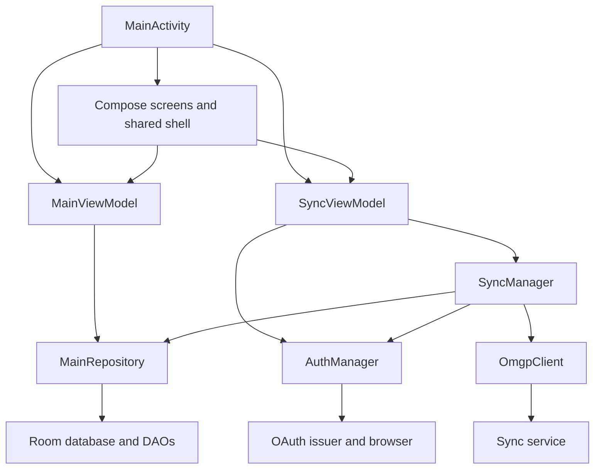

# Architecture and runtime lifecycle

> Source snapshot: `e53308af3921f454be1c661691b1fe546cb8f679` · reviewed 2026-10-11 UTC. See [scope and evidence](README.md#scope-and-evidence).

## Module and dependency structure

The repository has one Gradle application module, `:app`. Packages divide the implementation into `auth`, `data`, `sync`, and `ui`; UI is further split into navigation metadata, reusable components, screens, and theme. There is no DI framework, service locator interface, domain-module boundary, backend process, or separate API module. `OpenMgmtApp` directly constructs concrete collaborators. [Single module](https://github.com/black-candle-technologies/openmgmt-android/blob/e53308af3921f454be1c661691b1fe546cb8f679/settings.gradle.kts#L15-L16) [Composition root](https://github.com/black-candle-technologies/openmgmt-android/blob/e53308af3921f454be1c661691b1fe546cb8f679/app/src/main/java/com/openmgmt/android/OpenMgmtApp.kt#L10-L31)

The diagram describes dependencies and action flow. Observable data flows back from Room through the repository and ViewModel state to Compose. Credential stores are separate encrypted preferences owned by `AuthManager` and `SyncCredentials`; they are not Room tables. [Repository flows](https://github.com/black-candle-technologies/openmgmt-android/blob/e53308af3921f454be1c661691b1fe546cb8f679/app/src/main/java/com/openmgmt/android/data/Repository.kt#L48-L58) [Observable ViewModel](https://github.com/black-candle-technologies/openmgmt-android/blob/e53308af3921f454be1c661691b1fe546cb8f679/app/src/main/java/com/openmgmt/android/ui/MainViewModel.kt#L17-L35)

## Application creation

`OpenMgmtApp.onCreate` obtains `AppDatabase.get(applicationContext)`, creates `MainRepository`, creates `AuthManager(this)`, and constructs `SyncManager(repository, authManager, SyncCredentials(this))`. `AppDatabase.get` uses a volatile singleton with synchronized initialization. It opens `openmgmt.db`, registers migration 2→3, and allows destructive migration from version 1. The Room builder does not request main-thread database queries or a custom encrypted SQLite provider. [Application initialization](https://github.com/black-candle-technologies/openmgmt-android/blob/e53308af3921f454be1c661691b1fe546cb8f679/app/src/main/java/com/openmgmt/android/OpenMgmtApp.kt#L21-L30) [Database singleton](https://github.com/black-candle-technologies/openmgmt-android/blob/e53308af3921f454be1c661691b1fe546cb8f679/app/src/main/java/com/openmgmt/android/data/Database.kt#L279-L295)

Preference initialization is lazy inside both credential managers. Consequently, construction of `OpenMgmtApp` is not necessarily the point at which Keystore/preference errors surface; the first `isSignedIn`, token read, or registration-state read can trigger creation. `SyncViewModel` calls those status functions during initialization. No centralized recovery wrapper handles encrypted-preference initialization failure. [Auth lazy preferences](https://github.com/black-candle-technologies/openmgmt-android/blob/e53308af3921f454be1c661691b1fe546cb8f679/app/src/main/java/com/openmgmt/android/auth/AuthManager.kt#L61-L77) [Sync credential initialization](https://github.com/black-candle-technologies/openmgmt-android/blob/e53308af3921f454be1c661691b1fe546cb8f679/app/src/main/java/com/openmgmt/android/sync/SyncCredentials.kt#L15-L36) [State refresh](https://github.com/black-candle-technologies/openmgmt-android/blob/e53308af3921f454be1c661691b1fe546cb8f679/app/src/main/java/com/openmgmt/android/ui/SyncViewModel.kt#L39-L49)

## Activity and OAuth entry points

`MainActivity.onCreate` enables edge-to-edge rendering with transparent navigation-bar styles, disables enforced navigation-bar contrast on API 29+, forwards any OAuth deep link, obtains the two ViewModels through factories, and installs the Compose tree. `onNewIntent` forwards later deep links. The activity is exported, a launcher, and `singleTask`. [Activity startup](https://github.com/black-candle-technologies/openmgmt-android/blob/e53308af3921f454be1c661691b1fe546cb8f679/app/src/main/java/com/openmgmt/android/MainActivity.kt#L41-L78) [Manifest activity](https://github.com/black-candle-technologies/openmgmt-android/blob/e53308af3921f454be1c661691b1fe546cb8f679/app/src/main/AndroidManifest.xml#L14-L34)

The callback gate checks scheme `com.openmgmt.android` and path `/oauth2/callback`; it does not check host, port, action, or the configurable URI as an exact full string. It launches callback processing in `lifecycleScope`, logs an exception under tag OpenMGMT, and refreshes account state if the sync ViewModel has been initialized. `handleOAuthRedirect` runs before ViewModel construction on cold startup, making persisted auth state important. [Redirect path](https://github.com/black-candle-technologies/openmgmt-android/blob/e53308af3921f454be1c661691b1fe546cb8f679/app/src/main/java/com/openmgmt/android/MainActivity.kt#L122-L138)

## MainViewModel data model

`MainViewModel` converts projects and organizations to eager StateFlows, initially empty. Tasks combine the task observer with the visible project observer and retain only tasks with null parent IDs or parent IDs in that live set. The default Inbox project ID is derived from live projects/organizations. A project-name map and pending event count are separate eager flows. [Derived state](https://github.com/black-candle-technologies/openmgmt-android/blob/e53308af3921f454be1c661691b1fe546cb8f679/app/src/main/java/com/openmgmt/android/ui/MainViewModel.kt#L19-L35) [Name map](https://github.com/black-candle-technologies/openmgmt-android/blob/e53308af3921f454be1c661691b1fe546cb8f679/app/src/main/java/com/openmgmt/android/ui/MainViewModel.kt#L49-L52)

These are not paged lists. DAOs return every matching row, and screens filter/count/sort the lists in memory. Compose LazyColumns reduce rendering work but do not reduce database fetch size. Counts often perform per-project scans of tasks. This is reasonable for small local datasets but defines a scaling limit to evaluate with large task/event histories. No benchmark was run during this review.

Mutators return coroutine Jobs from `viewModelScope.launch`; they call the repository without an explicit result or user-facing error flow. The factories cast newly constructed ViewModels without checking `modelClass`. These simple choices keep wiring short but make additional consumers, retry UX, and isolated tests more difficult. [Mutation and factory methods](https://github.com/black-candle-technologies/openmgmt-android/blob/e53308af3921f454be1c661691b1fe546cb8f679/app/src/main/java/com/openmgmt/android/ui/MainViewModel.kt#L37-L58)

## SyncViewModel state machine

Its immutable State contains signedIn, registered, activity, message, isError, and lastSyncedAt. Activity is either SigningIn, Syncing, or null. Both signIn and syncNow return early if another activity exists; syncNow also requires `canSync`. The operation launches in `viewModelScope`, catches failures with `runCatching`, refreshes credential presence, and updates the visible message. Navigating away from Sync does not dispose of the ViewModel. [State](https://github.com/black-candle-technologies/openmgmt-android/blob/e53308af3921f454be1c661691b1fe546cb8f679/app/src/main/java/com/openmgmt/android/ui/SyncViewModel.kt#L20-L40) [Operations](https://github.com/black-candle-technologies/openmgmt-android/blob/e53308af3921f454be1c661691b1fe546cb8f679/app/src/main/java/com/openmgmt/android/ui/SyncViewModel.kt#L52-L94)

Sign-out is different: it clears OAuth preferences synchronously, then launches disconnect and state refresh without setting a busy activity and without a `runCatching` result path. The intended UI disables sign-out during a sign-in/sync, but direct calls to managers have fewer protections. A maintainer adding new callers should establish a shared session/sync lifecycle boundary instead of relying solely on button state. [Sign-out implementation](https://github.com/black-candle-technologies/openmgmt-android/blob/e53308af3921f454be1c661691b1fe546cb8f679/app/src/main/java/com/openmgmt/android/ui/SyncViewModel.kt#L96-L111)

## Threading and lifetime boundaries

| Component/path | Execution strategy | Important limit |
|---|---|---|
| UI | Compose/main thread | Screen filtering/sorting is in composition |
| Local writes | ViewModel coroutine → suspend Room transaction | Mutator does not surface error result |
| OAuth registration/token exchange | Blocking OkHttp inside `Dispatchers.IO` | No explicit coroutine-aware `Call.cancel` bridge |
| OAuth browser wait | Deferred with five-minute timeout | Browser cancellation is not a dedicated event |
| Token refresh | Auth mutex around access/refresh logic | Serializes refresh calls only within this instance |
| Sync run | `Dispatchers.IO` and `Mutex.tryLock` | Rejects overlapping sync runs |
| Remote page replay | Room transaction | Entity effects and checkpoint commit together |
| Sign-out | Preferences plus separate Room transaction | Not one atomic cross-store transaction |

[OAuth dispatch and waiting](https://github.com/black-candle-technologies/openmgmt-android/blob/e53308af3921f454be1c661691b1fe546cb8f679/app/src/main/java/com/openmgmt/android/auth/AuthManager.kt#L79-L115) [Refresh lock](https://github.com/black-candle-technologies/openmgmt-android/blob/e53308af3921f454be1c661691b1fe546cb8f679/app/src/main/java/com/openmgmt/android/auth/AuthManager.kt#L171-L185) [Sync lock](https://github.com/black-candle-technologies/openmgmt-android/blob/e53308af3921f454be1c661691b1fe546cb8f679/app/src/main/java/com/openmgmt/android/sync/SyncManager.kt#L60-L67) [Replay transaction](https://github.com/black-candle-technologies/openmgmt-android/blob/e53308af3921f454be1c661691b1fe546cb8f679/app/src/main/java/com/openmgmt/android/data/Repository.kt#L231-L257)

## Compose ownership

The route is `rememberSaveable`, resolved through the destination list. MainActivity provides one SnackbarHostState, wraps screen dispatch in `TaskActionsHost`, and delegates chrome/FAB management to `AppScaffold`. TaskActionsHost holds the open task snapshot plus an is-new flag using a custom Saver. Each editor field is also saveable. Project/organization screens store an editing ID and resolve the current object from observed lists. [Compose ownership](https://github.com/black-candle-technologies/openmgmt-android/blob/e53308af3921f454be1c661691b1fe546cb8f679/app/src/main/java/com/openmgmt/android/MainActivity.kt#L71-L112) [Task saver](https://github.com/black-candle-technologies/openmgmt-android/blob/e53308af3921f454be1c661691b1fe546cb8f679/app/src/main/java/com/openmgmt/android/ui/components/TaskEditor.kt#L104-L182) [Project editing ID](https://github.com/black-candle-technologies/openmgmt-android/blob/e53308af3921f454be1c661691b1fe546cb8f679/app/src/main/java/com/openmgmt/android/ui/screens/StructureScreens.kt#L74-L82)

A reusable composition-local action object lets every task list open the same editor or completion behavior. `ScreenFab` registers a specification with a shared controller and clears it when disposed. That avoids screen-local floating buttons overlapping snackbars. Layout insets include both system bars and display cutouts. [UI engineering](18-compose-design-and-accessibility.md) expands these details.

## Architectural boundaries to preserve

Local entity changes should go through `MainRepository`; bypassing it loses the same-transaction event invariant. Remote replay should not call those local save methods, because it would echo remote changes into new local events. Network credentials should remain outside the business database and payload baselines. New account identity behavior must coordinate both credential stores, checkpoint/snapshot state, applied-event history, and the single retained business dataset. Those recommendations follow directly from the present dependencies and are useful review criteria for future changes.

---

[Wiki home](README.md) · [Source coverage](24-source-coverage.md) · [Verification limits](20-testing-and-verification.md)
