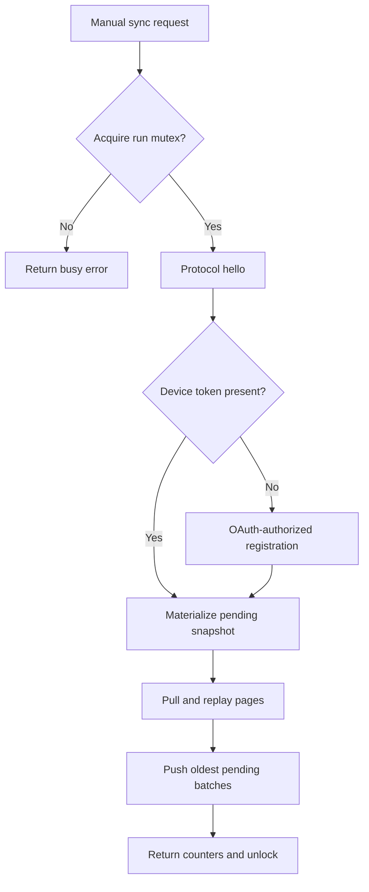

# Sync engine, conflicts, checkpoints, and failure semantics

> Source snapshot: `e53308af3921f454be1c661691b1fe546cb8f679` · reviewed 2026-10-11 UTC. See [scope and evidence](README.md#scope-and-evidence).

## One sync run

`SyncManager.syncOnce` moves execution to Dispatchers.IO, acquires a nonwaiting mutex, calls the private run method, and always unlocks in finally. Another concurrent caller receives “A sync is already running.” The method returns pushed, rejected, pulled, and applied counts; it does not persist a sync-session record. [Run lock/result](https://github.com/black-candle-technologies/openmgmt-android/blob/e53308af3921f454be1c661691b1fe546cb8f679/app/src/main/java/com/openmgmt/android/sync/SyncManager.kt#L38-L67)

Errors exit through the surrounding finally; completed database transactions and accepted-event markers remain durable. There is no distributed rollback of work already accepted by the server. [Run body](https://github.com/black-candle-technologies/openmgmt-android/blob/e53308af3921f454be1c661691b1fe546cb8f679/app/src/main/java/com/openmgmt/android/sync/SyncManager.kt#L69-L155)

## Device registration and recovery

Each run captures the current device ID. Initial registration occurs after hello if no device token exists. It requires AuthManager's token-presence signed-in check, obtains a valid/possibly refreshed access token, sends device model plus optional previous token/user hint, and stores the returned device credential and IDs. [Registration helper](https://github.com/black-candle-technologies/openmgmt-android/blob/e53308af3921f454be1c661691b1fe546cb8f679/app/src/main/java/com/openmgmt/android/sync/SyncManager.kt#L70-L96)

A wrapper around pull and push catches only `UnauthorizedException`, re-registers at most once per run when an account token is present, supplies the old device token as previous_device_token, and retries the same call. It does not rotate the device ID in this path. A second unauthorized error propagates. Initial hello and registration are outside this wrapper. Generic HTTP 401 does not become UnauthorizedException, so it does not trigger this recovery. [Authorized wrapper](https://github.com/black-candle-technologies/openmgmt-android/blob/e53308af3921f454be1c661691b1fe546cb8f679/app/src/main/java/com/openmgmt/android/sync/SyncManager.kt#L98-L110) [Transport exceptions](https://github.com/black-candle-technologies/openmgmt-android/blob/e53308af3921f454be1c661691b1fe546cb8f679/app/src/main/java/com/openmgmt/android/sync/OmgpClient.kt#L54-L60)

## Snapshot ordering

A snapshot is materialized before any pull. A migration or sign-out can mark it pending. The repository replaces pending event history with one updated full-state event per stored organization/project/task, including archives. Those newly pending events shield local entities from all matching remote events during this run's pull. This gives the restored/retained local dataset precedence. After sign-out and another account's sign-in, the later sync therefore attempts to push that dataset under the newly registered account's device credentials. The server must accept the events for remote transfer to complete. [Snapshot mechanics](https://github.com/black-candle-technologies/openmgmt-android/blob/e53308af3921f454be1c661691b1fe546cb8f679/app/src/main/java/com/openmgmt/android/data/Repository.kt#L184-L219)

A fresh installation with ordinary local edits already has corresponding events and does not need the snapshot flag for first sync. Snapshot is a specific reset/migration mechanism, not a routine periodic export. It removes only pending rows; accepted history and dedupe history remain.

## Pull pagination and checkpoint atomicity

The manager requests 500 events per pull and repeats for at most 200 pages. For each response, pulled count increases by response event count, and `applyRemotePage` returns a counted-applied value. It stops when has_more is false or events is empty. At the safety limit it proceeds to pushing without an explicit “pull incomplete” error. A server obeying the limit can therefore return at most 100,000 events in that run before the loop stops; the client does not enforce 500 as a response-size bound. [Constants](https://github.com/black-candle-technologies/openmgmt-android/blob/e53308af3921f454be1c661691b1fe546cb8f679/app/src/main/java/com/openmgmt/android/sync/SyncManager.kt#L11-L14) [Pull loop](https://github.com/black-candle-technologies/openmgmt-android/blob/e53308af3921f454be1c661691b1fe546cb8f679/app/src/main/java/com/openmgmt/android/sync/SyncManager.kt#L115-L124)

Within the repository transaction, page effects, processed-event markers, and a nonempty checkpoint commit together. If the process dies before commit, the page can be re-fetched; duplicate IDs handle replays after successful prior commits. Blank checkpoints are ignored. There is no comparison requiring a new checkpoint to differ from the old one, no bounded response-byte parser, and no stalled-pagination warning. A server repeatedly returning the same nonempty page can consume the 200 iterations while most records are deduplicated. [Replay transaction](https://github.com/black-candle-technologies/openmgmt-android/blob/e53308af3921f454be1c661691b1fe546cb8f679/app/src/main/java/com/openmgmt/android/data/Repository.kt#L231-L257)

## Replay order and what gets counted

The page is sorted with organizations first, projects second, and tasks/other types last; ordering within a type follows the input ordering. The code is not globally sorting by event created_at, sequence, or entity updated_at. It relies on server page order for same-type chronology. There are no local foreign keys requiring this category ordering, but it aligns with the parent-before-child model.

| Event condition | Handler runs? | Marked processed? | Increments applied? |
|---|---:|---:|---:|
| Same device ID as current run | No | No new marker | No |
| Event ID already recorded | No | Already present | No |
| Pending local event for same type/ID | No | Yes | No |
| Handler completes normally | Yes | Yes | Yes |
| Handler throws | Yes | Yes, after logged failure | No |
| Archive references absent row | Yes, no-op | Yes | Yes |

[Replay branches](https://github.com/black-candle-technologies/openmgmt-android/blob/e53308af3921f454be1c661691b1fe546cb8f679/app/src/main/java/com/openmgmt/android/data/Repository.kt#L237-L255) [Archive no-op handling](https://github.com/black-candle-technologies/openmgmt-android/blob/e53308af3921f454be1c661691b1fe546cb8f679/app/src/main/java/com/openmgmt/android/data/Repository.kt#L261-L277)

Because failed/unsupported events are marked processed and the checkpoint advances, upgrading the client later does not automatically replay those IDs. Clearing a checkpoint alone would still encounter the dedupe table. The code provides no retry/quarantine interface for such events.

## Conflict model

The conflict unit is the entire entity identified by `(entity_type, entity_id)`. If any local event for it has null syncedAt, all incoming events for that entity are skipped during pull. Android then pushes the queued full-entity snapshots, intending them to land later in server order. This is local-pending precedence within a server-ordered last-writer model, not timestamp comparison or a collaborative merge. [Conflict rationale and guard](https://github.com/black-candle-technologies/openmgmt-android/blob/e53308af3921f454be1c661691b1fe546cb8f679/app/src/main/java/com/openmgmt/android/data/Repository.kt#L221-L251)

Example, derived from the source:

1. Both devices accepted a task with title A and no notes.
2. Desktop adds important notes and pushes.
3. Android, before pulling those notes, edits only the title to B and queues a full entity.
4. Android pulls the desktop event but skips it because its task has pending work.
5. Android pushes title B with its older notes baseline.

The Android title edit survives, but the new desktop notes can be replaced. The same issue applies to desktop-only fields preserved in `remoteJson`: preservation works from the last accepted baseline, not a skipped concurrent event. A field-level merge would require new logic and conflict tests.

No client check compares archive time against later create/update time. An archive of a missing entity is not stored as a standalone entity tombstone; only its processed event ID remains. A subsequent valid full-entity event can insert the row. The expected authoritative history ordering belongs to the server contract.

## Push batching and acknowledgments

After pulls finish, the manager reads the oldest 500 pending events by ascending sequence, reconstructs JSON payload objects, stamps the current device ID, and sends them with the current pull checkpoint as base_checkpoint. Actor/target/workspace fields are left at null defaults. Event UUID and sequence remain the local identities for retries. [Outbox order](https://github.com/black-candle-technologies/openmgmt-android/blob/e53308af3921f454be1c661691b1fe546cb8f679/app/src/main/java/com/openmgmt/android/data/Database.kt#L169-L170) [Outgoing push](https://github.com/black-candle-technologies/openmgmt-android/blob/e53308af3921f454be1c661691b1fe546cb8f679/app/src/main/java/com/openmgmt/android/sync/SyncManager.kt#L128-L145)

Returned accepted IDs are intersected with the sent set and deduplicated before marking rows synced. This protects unrelated pending rows from a response containing arbitrary accepted IDs. Rejected events and merely unacknowledged events remain pending. If fewer than the full batch were accepted, the run stops pushing; accepted members still remain marked. A large set of old permanently rejected events can occupy the next batch repeatedly and prevent later records from reaching the server. No skip/quarantine/dead-letter operation exists. [Acceptance handling](https://github.com/black-candle-technologies/openmgmt-android/blob/e53308af3921f454be1c661691b1fe546cb8f679/app/src/main/java/com/openmgmt/android/sync/SyncManager.kt#L146-L153)

The manager does not use the push response's server_checkpoint. Keeping the pull checkpoint avoids skipping events appended by other devices around this push; on a later sync, own echoes can be pulled and skipped by device ID. This explanation is an inference from the deliberate separation of push and pull checkpoints. The next sync also provides the next opportunity to see events that arrived after the previous pull; there is no post-push pull.

## Partial failure and retry matrix

| Failure point | Durable state after failure | Expected later behavior |
|---|---|---|
| Before hello/register succeeds | Existing local events remain | Retry manually after resolving cause |
| Registration succeeds, pull fails | Device credentials may be stored | Next run can skip initial registration |
| During page before Room commit | Transaction rolls back | Same page may be re-fetched |
| Individual event handler throws | Other page changes/checkpoint can commit; failed ID marked | Event is not automatically retried |
| Server accepts push, response lost | Local events can remain pending | Same event IDs/sequences may be resent; server dedupe is required |
| Some accepted, some rejected | Accepted IDs marked; others pending | Next manual run retries pending batch |
| Non-2xx OAuth refresh | OAuth credentials cleared | Fresh sign-in needed under current implementation |
| Process death | Committed Room/preference state remains; UI state lost | Manual restart/sync; exact in-flight network outcome may be unknown |

The client does not provide exactly-once network delivery by itself. It provides durable event identity and retryable local state; server acceptance and deduplication must complete the contract.

## Operational limits and recommendations

Pull has a page cap but no overall data-byte cap. Push has no batch-count/time cap and can continue as long as full batches are accepted, including events created while the run is active. Synchronous OkHttp calls run on IO but are not explicitly connected to coroutine cancellation. Sign-out/disconnect is not guarded by the same sync mutex, although the current UI disallows sign-out during activity. [Run and disconnect](https://github.com/black-candle-technologies/openmgmt-android/blob/e53308af3921f454be1c661691b1fe546cb8f679/app/src/main/java/com/openmgmt/android/sync/SyncManager.kt#L50-L67) [Push loop](https://github.com/black-candle-technologies/openmgmt-android/blob/e53308af3921f454be1c661691b1fe546cb8f679/app/src/main/java/com/openmgmt/android/sync/SyncManager.kt#L128-L153)

Prioritized engineering improvements are explicit incomplete-pull detection, progress-aware pagination, observable rejected/skipped event diagnostics, a bounded poison-event recovery strategy, tested account partitioning, and well-defined cancellation/session-generation behavior. These are recommendations; no such mechanisms should be claimed in user or operator documentation until implemented and tested.

---

[Wiki home](README.md) · [Source coverage](24-source-coverage.md) · [Verification limits](20-testing-and-verification.md)
